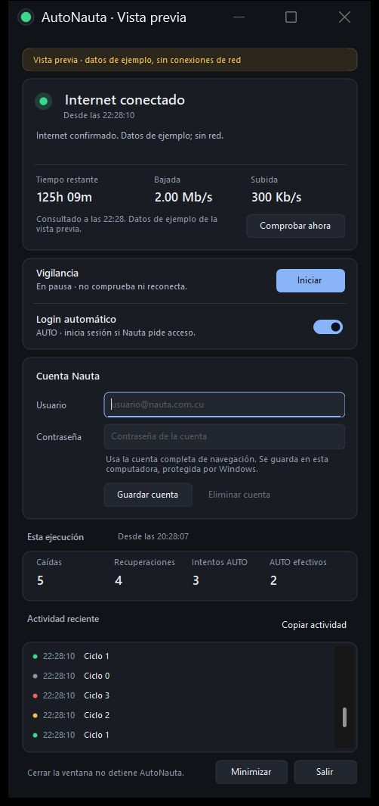

# AutoNauta

**Reconexión automática de Nauta Hogar para Windows**, con un indicador discreto, tiempo restante de la cuenta y velocidades de subida y bajada del equipo.

[Descargar AutoNauta 2.4.3 beta](https://github.com/JoeSagera/AutoNauta/releases/tag/v2.4.3) · [Guía de uso](docs/GUIA-AMIGOS.txt) · [Seguridad](SECURITY.md) · [Licencia MIT](LICENSE)

Ver la ventana principal (datos ficticios)

## Empezar

1. Descarga **AutoNauta-v2.4.3-windows-x64.zip** desde la Release. Los enlaces «Source code» son el código fuente, no el programa listo para abrir.
2. Extrae el ZIP completo y abre `AutoNauta.exe`. Es portátil y no necesita permisos de administrador.
3. Introduce tu propia cuenta de navegación terminada en `@nauta.com.cu` y su contraseña; pulsa **Guardar cuenta** y después **Iniciar**.
4. Minimiza o cierra la ventana con la X: el indicador y la vigilancia siguen funcionando. Para cerrar el programa, elige **Salir**.

Para actualizar, sal de la versión anterior y sustituye el ejecutable. Tus datos y preferencias están fuera de la carpeta del programa. Los contadores de esta ejecución se reinician al volver a abrirlo.

## Qué hace

Mientras hay Internet, espera y comprueba la conexión. Si falla, distingue la falta de enlace físico de una sesión Nauta que necesita acceso. Solo intenta iniciar sesión cuando reconoce el portal HTTPS y el modo **AUTO** está activado; no depende de que el navegador abra un popup.

- **Verde:** Internet confirmado. El indicador se oculta en el lateral más cercano y deja una pequeña muesca; al pasar el mouse muestra la barra.
- **Amarillo:** comprobación, espera o intento de reconexión.
- **Rojo:** error de acceso, portal o cuenta.
- **Gris:** pausa o espera de confirmación.

La chincheta mantiene la información visible. Al retirar el mouse se esconden AUTO/MAN y la chincheta; reaparecen al volver. Arrastra el LED para cambiar su posición y haz doble clic para abrir la ventana. El menú junto al reloj ofrece **Recuperar LED**.

**MAN** mantiene la vigilancia sin iniciar sesión automáticamente. **Pausar** detiene las comprobaciones; no cierra una sesión Nauta existente. El indicador recupera su prioridad frente a otras ventanas sin quitarles el foco. El usuario confirmó que se ve encima de BF6 en su configuración de pantalla completa; no se garantiza compatibilidad universal con todos los juegos.

## Horas, velocidades y actividad

El tiempo restante se obtiene de una sesión confirmada por Nauta y se actualiza cada minuto. Si iniciaste sesión en el navegador y no aparece, actualiza la página conectada de Nauta, guárdala como HTML y elige **Vincular contador del navegador…** en el menú del LED. El archivo contiene datos privados de tu sesión: no lo compartas. AutoNauta verifica el contador con el servidor sin repetir ni cerrar el login.

Las velocidades son **bits por segundo del equipo**, incluyen tráfico LAN y sobrecarga de VPN y no son un test de velocidad ni miden otros dispositivos del router. Las estadísticas cuentan caídas confirmadas, recuperaciones, intentos AUTO y AUTO efectivos desde el inicio de esta ejecución. El login solo cuenta como efectivo después de ser aceptado y recuperar Internet.

La actividad se puede copiar con **Copiar actividad** o Ctrl+C. Ctrl+A selecciona las filas mostradas y doble clic abre un detalle seleccionable. El menú permite ver el registro completo.

## Compatibilidad y límites

Probado con **Windows 11 x64 y Nauta Hogar**. Requiere .NET Framework 4.8; Windows 10 x64 no se ha validado con esta entrega. No requiere VPN y no modifica rutas ni conecta/desconecta tu VPN. Un cliente VPN o un cortafuegos que bloquee el portal puede impedir la reconexión.

No repara una línea ADSL sin señal, no añade saldo ni evita el consumo de tiempo de Nauta. No se inicia automáticamente con Windows. Es una **beta**: hubo reconexión automática real y contador confirmado por el usuario, además de pruebas locales; no es una garantía de funcionamiento ante cualquier caída o cambio del portal.

El ejecutable **no está firmado digitalmente**. Comprueba que lo descargaste de este repositorio y verifica el SHA256 publicado; la suma comprueba integridad y no equivale a una firma. No publiques tu configuración, HTML del portal ni diagnósticos sin revisarlos.

## Privacidad y seguridad

La contraseña y el contexto de sesión se cifran con DPAPI para tu usuario de Windows en `%LOCALAPPDATA%\AutoNauta`. **El nombre de usuario y las preferencias se guardan en texto legible.** El paquete no incluye configuración ni datos personales. **Eliminar cuenta** quita los datos guardados por AutoNauta; no cierra la sesión del portal ni borra HTML que hayas guardado aparte.

El login usa HTTPS con comprobación de nombre, vigencia y confianza del certificado y un destino Nauta restringido. No hay servicios de telemetría de AutoNauta. Las comprobaciones de conectividad contactan servicios de Microsoft/Google y, cuando falla Internet, el router y el portal Nauta; esos destinos pueden observar la conexión y su IP de salida. Detalles y límites del modelo de seguridad: [SECURITY.md](SECURITY.md).

## Desarrollo y validación

Fuentes C# / Windows Forms en `src/`, sin paquetes de terceros que descargar. Con AutoNauta cerrado, ejecuta `./Compilar.ps1` en PowerShell para compilar y ejecutar las pruebas. La entrega queda en `outputs/AutoNauta/AutoNauta.exe`. `./Preparar-Release.ps1` prepara el ZIP y sus sumas SHA256; no publica por sí solo una Release.

Para colaborar, consulta [CONTRIBUTING.md](CONTRIBUTING.md). La arquitectura y los comandos de comprobación están en [docs/DESARROLLO.md](docs/DESARROLLO.md). Las decisiones antiguas se conservan en [el historial](docs/HISTORIAL-DESARROLLO.md), y las notas de versiones en [docs/releases](docs/releases/).

## Licencia y créditos

Copyright © 2026 JoeSagera. Licencia [MIT](LICENSE): puedes usar, modificar y redistribuir respetando sus condiciones. AutoNauta es un proyecto independiente y **no está afiliado a ETECSA ni a proveedores de VPN**. El diseño visual contó con Claude y la implementación y revisión con Codex. El protocolo se contrastó con el portal y con el [cliente Nauta de raulodev](https://github.com/raulodev/nauta); ese proyecto conserva su propia licencia.
